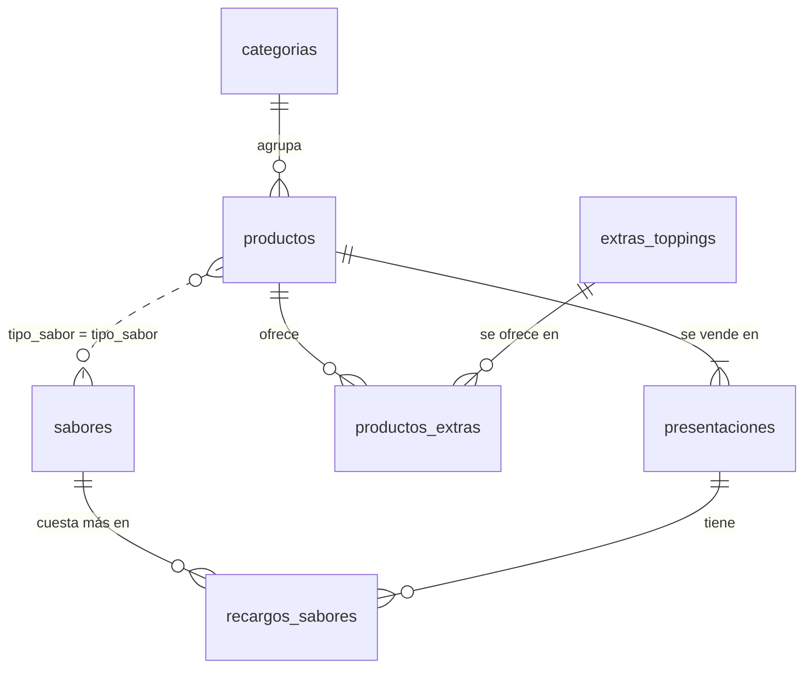
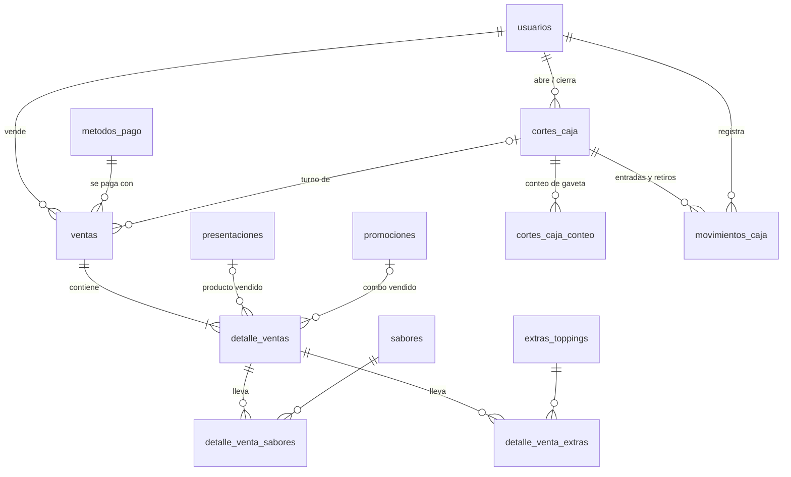
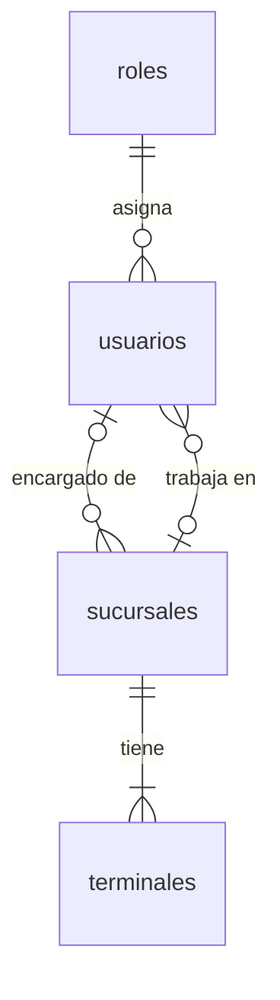
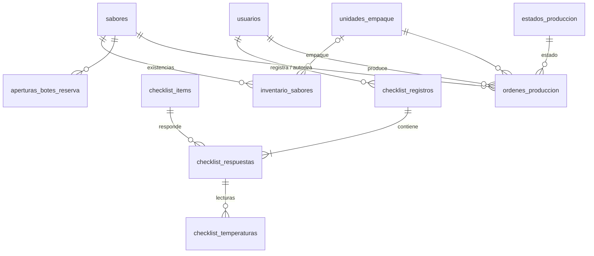

# Modelo de base de datos — `conitos_central_pos`

MySQL / MariaDB, `utf8mb4_unicode_ci`, motor InnoDB. Estado al **20 de octubre de 2026**.

- Estructura completa en SQL (sin datos): [esquema.sql](esquema.sql)
- Las tablas **base** ya existían antes del API (usuarios, catálogo, ventas, producción, checklist). Las **migraciones** de `app/Database/Migrations` agregan columnas y tablas nuevas sobre ellas (ver [Historial de cambios](#historial-de-cambios-migraciones)).
- Convención: lo que ya tiene ventas **no se borra, se desactiva** (`activo = 0`). Borrar sabores, presentaciones o extras vendidos arrastraría el detalle de ventas por las reglas `ON DELETE CASCADE / SET NULL`, por eso el API lo impide.

## Módulos

| Módulo | Tablas |
|---|---|
| Usuarios y acceso | `roles`, `usuarios` |
| Sucursales | `sucursales`, `terminales` |
| Catálogo | `categorias`, `productos`, `presentaciones`, `sabores`, `recargos_sabores`, `extras_toppings`, `productos_extras`, `promociones`, `metodos_pago` |
| Ventas | `ventas`, `detalle_ventas`, `detalle_venta_sabores`, `detalle_venta_extras` |
| Caja | `cortes_caja`, `cortes_caja_conteo`, `movimientos_caja` |
| Checklist de apertura | `checklist_items`, `checklist_registros`, `checklist_respuestas`, `checklist_temperaturas` |
| Inventario y producción *(sin uso en la app todavía)* | `inventario_sabores`, `unidades_empaque`, `aperturas_botes_reserva`, `ordenes_produccion`, `estados_produccion` |
| Sistema | `migrations` (control de migraciones de CodeIgniter) |

---

## Diagramas

### Catálogo

> `productos.tipo_sabor` ↔ `sabores.tipo_sabor` no es llave foránea: es el texto que indica qué familia de sabores se ofrece (Helado, Paleta Agua, Paleta Crema, Agua Fresca).

### Ventas y caja

### Usuarios y sucursales

### Checklist, inventario y producción

---

## Tablas

Notación: **PK** llave primaria · **FK** llave foránea (regla al borrar el padre) · **UQ** único · *nuevo* = agregado por migración.

### Usuarios y acceso

#### `roles`
| Columna | Tipo | Notas |
|---|---|---|
| `id_rol` | int | PK. 1 Administrador · 2 Vendedor / Cajero · 3 Productor · 4 Encargado Compras |
| `nombre` | varchar(50) | |
| `descripcion` | varchar(150) | |

#### `usuarios`
| Columna | Tipo | Notas |
|---|---|---|
| `id_usuario` | int | PK |
| `id_rol` | int | FK → `roles` (RESTRICT) |
| `id_sucursal` | int, null | *nuevo*. FK → `sucursales` (SET NULL). Dónde trabaja |
| `nombre` | varchar(100) | |
| `usuario` | varchar(50) | UQ. Minúsculas, números, `.` `-` `_` |
| `password_hash` | varchar(255) | bcrypt costo 12. Nunca sale del API |
| `activo` | tinyint(1) | Desactivado = no entra y su token deja de servir |
| `ultimo_acceso` | datetime, null | *nuevo*. Se actualiza en cada login |
| `fecha_creacion` | datetime | |

### Sucursales

#### `sucursales` *(nueva)*
| Columna | Tipo | Notas |
|---|---|---|
| `id_sucursal` | int | PK |
| `codigo` | varchar(20) | UQ. p. ej. `SUC-001` |
| `nombre` | varchar(100) | Único (validado en el API) |
| `direccion`, `telefono`, `correo` | varchar, null | |
| `id_encargado` | int, null | FK → `usuarios` (SET NULL) |
| `hora_apertura`, `hora_cierre` | time, null | |
| `venta_mostrador`, `para_llevar`, `apps_delivery`, `drive_thru` | tinyint(1) | Modalidades de venta |
| `es_matriz` | tinyint(1) | La matriz no se desactiva ni se borra |
| `activo` | tinyint(1) | |
| `created_at`, `updated_at` | datetime | |

#### `terminales` *(nueva)*
| Columna | Tipo | Notas |
|---|---|---|
| `id_terminal` | int | PK |
| `id_sucursal` | int | FK → `sucursales` (CASCADE) |
| `nombre` | varchar(50) | p. ej. `Caja #01 Principal` |
| `tipo` | enum `CAJA` `TABLET` `KIOSKO` | |
| `activo` | tinyint(1) | |

### Catálogo

#### `categorias`
| Columna | Tipo | Notas |
|---|---|---|
| `id_categoria` | int | PK |
| `nombre` | varchar(50) | Único (validado en el API) |
| `activo` | tinyint(1) | *nuevo* |

#### `productos`
| Columna | Tipo | Notas |
|---|---|---|
| `id_producto` | int | PK |
| `id_categoria` | int | FK → `categorias` (CASCADE) |
| `nombre` | varchar(100) | Único dentro de su categoría (API) |
| `requiere_sabor` | tinyint(1) | El POS pide sabor |
| `tipo_sabor` | varchar(30), null | *nuevo*. Familia de sabores que se ofrece |
| `activo` | tinyint(1) | *nuevo* |

#### `presentaciones`
| Columna | Tipo | Notas |
|---|---|---|
| `id_presentacion` | int | PK |
| `id_producto` | int | FK → `productos` (CASCADE) |
| `nombre` | varchar(50) | "Única" si el producto tiene un solo precio |
| `precio_base` | decimal(8,2) | Precio de venta |
| `num_sabores` | tinyint | *nuevo*. Sabores a elegir (Chico 1 bola = 1, Grande = 2) |
| `activo` | tinyint(1) | *nuevo* |

#### `sabores`
| Columna | Tipo | Notas |
|---|---|---|
| `id_sabor` | int | PK |
| `nombre` | varchar(50) | |
| `tipo_sabor` | varchar(30) | Helado · Paleta Agua · Paleta Crema · Agua Fresca |
| `es_especial` | tinyint(1) | Premium (suele llevar recargo) |
| `activo` | tinyint(1) | *nuevo* |

#### `recargos_sabores`
| Columna | Tipo | Notas |
|---|---|---|
| `id_recargo` | int | PK |
| `id_sabor` | int | FK → `sabores` (CASCADE) |
| `id_presentacion` | int | FK → `presentaciones` (CASCADE) |
| `monto_recargo` | decimal(8,2) | Se suma por cada porción de ese sabor en esa presentación |

#### `extras_toppings`
| Columna | Tipo | Notas |
|---|---|---|
| `id_extra` | int | PK |
| `nombre` | varchar(50) | |
| `precio` | decimal(8,2) | |
| `activo` | tinyint(1) | *nuevo* |

#### `productos_extras` *(nueva)*
| Columna | Tipo | Notas |
|---|---|---|
| `id_producto` | int | PK, FK → `productos` (CASCADE) |
| `id_extra` | int | PK, FK → `extras_toppings` (CASCADE) |

#### `promociones`
| Columna | Tipo | Notas |
|---|---|---|
| `id_promocion` | int | PK |
| `nombre` | varchar(100) | |
| `precio_combo` | decimal(8,2) | |
| `dia_semana` | int, null | 1 = domingo … 7 = sábado (`DAYOFWEEK`). `null` = todos los días |
| `activa` | tinyint(1) | |

#### `metodos_pago`
| Columna | Tipo | Notas |
|---|---|---|
| `id_metodo` | int | PK. 1 Efectivo · 2 Tarjeta de Débito · 3 Tarjeta de Crédito |
| `nombre` | varchar(50) | El front agrupa Débito y Crédito como "Tarjeta" |

### Ventas

**Precio de una línea** = `precio_base` de la presentación + recargo de cada porción de sabor en esa presentación + extras (o `precio_combo` si es promoción). Lo calcula el API al registrar; el POS solo lo usa para validar.

#### `ventas`
| Columna | Tipo | Notas |
|---|---|---|
| `id_venta` | int | PK. Es el número de ticket |
| `folio_orden` | int, null | *nuevo*. Número de orden que ve el cliente en el POS |
| `id_corte` | int, null | *nuevo*. FK → `cortes_caja` (SET NULL). Turno de caja |
| `id_usuario_vendedor` | int | FK → `usuarios` (RESTRICT) |
| `fecha_hora` | datetime | Hora local del servidor |
| `cliente` | varchar(100), null | *nuevo* |
| `tipo_servicio` | enum `AQUI` `LLEVAR` | *nuevo* |
| `id_metodo_pago` | int | FK → `metodos_pago` (RESTRICT) |
| `subtotal` | decimal(10,2) | *nuevo* |
| `descuento` | decimal(10,2) | *nuevo* |
| `descuento_concepto` | varchar(100), null | *nuevo*. Nombre del descuento aplicado |
| `total` | decimal(10,2) | `subtotal − descuento` |
| `monto_recibido` | decimal(10,2), null | *nuevo*. Solo efectivo |
| `cambio` | decimal(10,2), null | *nuevo*. Solo efectivo |

#### `detalle_ventas`
| Columna | Tipo | Notas |
|---|---|---|
| `id_detalle` | int | PK |
| `id_venta` | int | FK → `ventas` (CASCADE) |
| `id_presentacion` | int, null | FK → `presentaciones` (SET NULL). Producto vendido |
| `id_promocion` | int, null | FK → `promociones` (SET NULL). Combo vendido |
| `cantidad` | int | |
| `precio_unitario` | decimal(8,2) | Ya incluye recargos y extras |
| `subtotal` | decimal(10,2) | `precio_unitario × cantidad` |
| `notas` | varchar(255), null | *nuevo*. Preparación o contenido del combo |

#### `detalle_venta_sabores`
| Columna | Tipo | Notas |
|---|---|---|
| `id_detalle_sabor` | int | PK |
| `id_detalle` | int | FK → `detalle_ventas` (CASCADE) |
| `id_sabor` | int | FK → `sabores` (CASCADE). **Un renglón por porción** (2× Vainilla = 2 renglones) |

#### `detalle_venta_extras`
| Columna | Tipo | Notas |
|---|---|---|
| `id_detalle_extra` | int | PK |
| `id_detalle` | int | FK → `detalle_ventas` (CASCADE) |
| `id_extra` | int | FK → `extras_toppings` (CASCADE) |
| `cantidad` | int | |
| `precio_unitario` | decimal(8,2) | Precio del extra al momento de la venta |

### Caja

Un **turno** se abre con fondo (`ABIERTO`) y se cierra con el corte Z (`CERRADO`). Solo puede haber un turno abierto. Las ventas cobradas sin caja abierta se asignan al turno que se abra **ese mismo día**.

#### `cortes_caja` *(nueva)*
| Columna | Tipo | Notas |
|---|---|---|
| `id_corte` | int | PK. Folio del corte Z |
| `estado` | enum `ABIERTO` `CERRADO` | |
| `id_usuario_apertura` / `id_usuario_cierre` | int | FK → `usuarios` (RESTRICT) |
| `fecha_apertura` / `fecha_cierre` | datetime | |
| `fondo_inicial` | decimal(10,2) | |
| `comentario_apertura` | varchar(255), null | |
| `tickets`, `ventas_brutas`, `descuentos`, `ventas_netas`, `ventas_efectivo`, `ventas_tarjeta` | | Totales **congelados al cerrar** |
| `entradas`, `retiros` | decimal(10,2) | De `movimientos_caja` |
| `efectivo_esperado` | decimal(10,2) | `fondo + ventas en efectivo + entradas − retiros` |
| `efectivo_contado`, `diferencia_efectivo` | decimal(10,2) | Contado − esperado |
| `tarjeta_terminal`, `vouchers`, `diferencia_tarjeta` | | Cierre de lote de la terminal bancaria vs. sistema |
| `observaciones` | text, null | Obligatorias si hay diferencias |

#### `cortes_caja_conteo` *(nueva)*
| Columna | Tipo | Notas |
|---|---|---|
| `id_corte` | int | PK, FK → `cortes_caja` (CASCADE) |
| `denominacion` | decimal(8,2) | PK. 1000, 500, 200, 100, 50, 20, 10, 5, 2, 1, 0.50 |
| `piezas` | int | |

#### `movimientos_caja` *(nueva)*
| Columna | Tipo | Notas |
|---|---|---|
| `id_movimiento` | int | PK |
| `id_corte` | int | FK → `cortes_caja` (CASCADE) |
| `id_usuario` | int | FK → `usuarios` (RESTRICT) |
| `tipo` | enum `ENTRADA` `RETIRO` | |
| `monto` | decimal(10,2) | Un retiro no puede superar el efectivo esperado |
| `concepto` | varchar(150) | |
| `fecha_hora` | datetime | |

### Checklist de apertura

| Tabla | Para qué |
|---|---|
| `checklist_items` | Puntos a revisar: `tipo_campo` (`BOOLEAN`, `SELECT`, `TEMPERATURE_PAIR`, `TEXT`), `config` JSON con opciones o sensores y rangos, `orden`, `es_obligatorio`, `activo` |
| `checklist_registros` | Uno por día (`fecha` UQ): `COMPLETADO` u `OMITIDO`, `con_incidencia`, `comentarios`, quién lo hizo y quién autorizó la omisión |
| `checklist_respuestas` | Respuesta por punto (`id_registro` + `id_item` UQ): `cumplido`, `valor` |
| `checklist_temperaturas` | Lecturas por sensor: `grados`, `en_rango` |

Detalle en [endpoints/checklist.md](endpoints/checklist.md).

### Inventario y producción *(sin uso en la app)*

| Tabla | Contenido |
|---|---|
| `inventario_sabores` | Por sabor: `botes_reserva`, `stock_minimo_reserva`, `porciones_vitrina_actual` / `_max`, `id_empaque`. Administración solo lo **muestra** |
| `unidades_empaque` | Bote 5 L (40 porciones), Bote 10 L (80) |
| `aperturas_botes_reserva` | Bitácora de botes abiertos para vitrina |
| `ordenes_produccion` | Botes producidos por sabor, productor y estado |
| `estados_produccion` | Catálogo de estados de una orden |

---

## Historial de cambios (migraciones)

| Migración | Qué agrega |
|---|---|
| `2026-10-20-150000_ChecklistApertura` | Columnas de `checklist_items` y tablas `checklist_registros`, `checklist_respuestas`, `checklist_temperaturas` |
| `2026-10-20-180000_CatalogoActivo` | `activo` en `categorias`, `productos`, `presentaciones`, `sabores`, `extras_toppings` |
| `2026-10-20-200000_CatalogoPos` | `productos.tipo_sabor`, `presentaciones.num_sabores`, tabla `productos_extras` (con valores iniciales deducidos de los nombres) |
| `2026-10-20-220000_VentasPos` | En `ventas`: `folio_orden`, `cliente`, `tipo_servicio`, `subtotal`, `descuento`, `descuento_concepto`, `monto_recibido`, `cambio`. En `detalle_ventas`: `notas` |
| `2026-10-20-240000_CortesCaja` | Tablas `cortes_caja`, `cortes_caja_conteo`, `movimientos_caja` y `ventas.id_corte` |
| `2026-10-21-100000_Sucursales` | Tablas `sucursales` y `terminales`; registra la matriz (`SUC-001`) con `Caja #01` |
| `2026-10-21-110000_UsuariosCatalogo` | `usuarios.id_sucursal` (los existentes quedan en la matriz) y `usuarios.ultimo_acceso` |

Para instalar en un servidor nuevo, ver [PENDIENTES.md](PENDIENTES.md#base-de-datos): hoy las tablas base no tienen migración.
